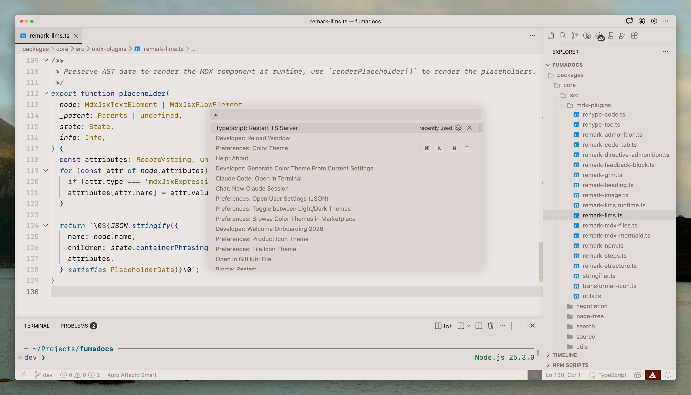
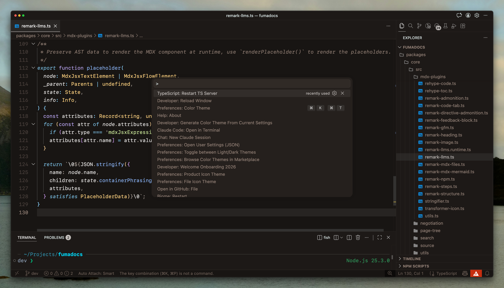

# Material Stone

A warm, high-contrast palette.

## Installation

- [Visual Studio Code](./themes/vscode/README.md)
  - [Marketplace](https://marketplace.visualstudio.com/items?itemName=te6.material-stone)
- [Claude Code](./themes/claude-code/README.md) (dark only)
- [fish](./themes/fish/README.md) (dark only)

## Palette

[`color.yaml`](./color.yaml) is the source of truth, and the only file here that
holds a hex. It has two layers: a palette of raw values named by hue and by
distance from the background, and semantic tokens that each point at one palette
entry. Role groups stay independent even where they land on the same value —
`ansi.red` is a contract with every program you run, `syntax.tag` is a styling
choice, and one must not move because the other did.

Every theme file under `themes/` is generated. Each has a template in
[`templates/`](./templates) that is its native format verbatim, with token
expressions where the colors go, so nothing about a tool's file needs modeling:
modifier flags, scope arrays, and repeated keys survive untouched. Targets that
cannot express alpha get it flattened against a ground they declare.

```sh
bun run build   # regenerate every theme
bun run check   # fail if a generated file no longer matches its template
bun test
```

The dark variant is tokenized. The light VS Code theme is still hand-authored.

## Screenshots



